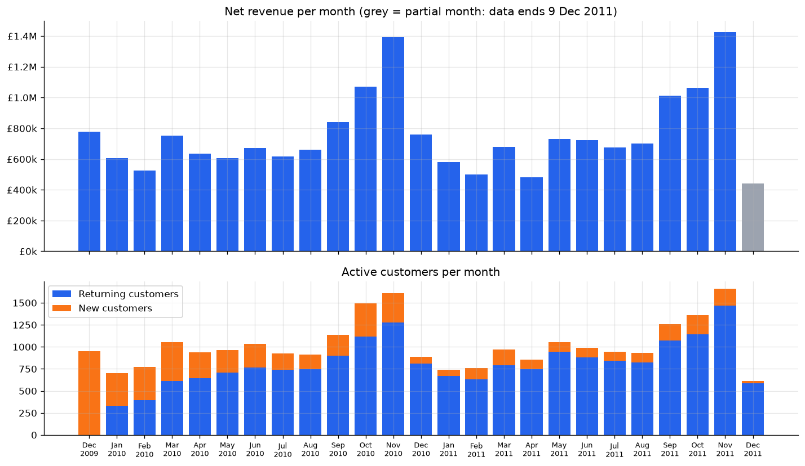
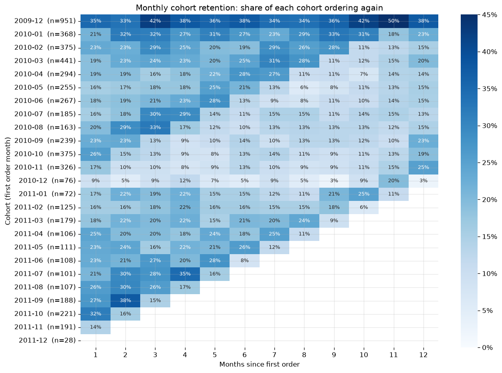
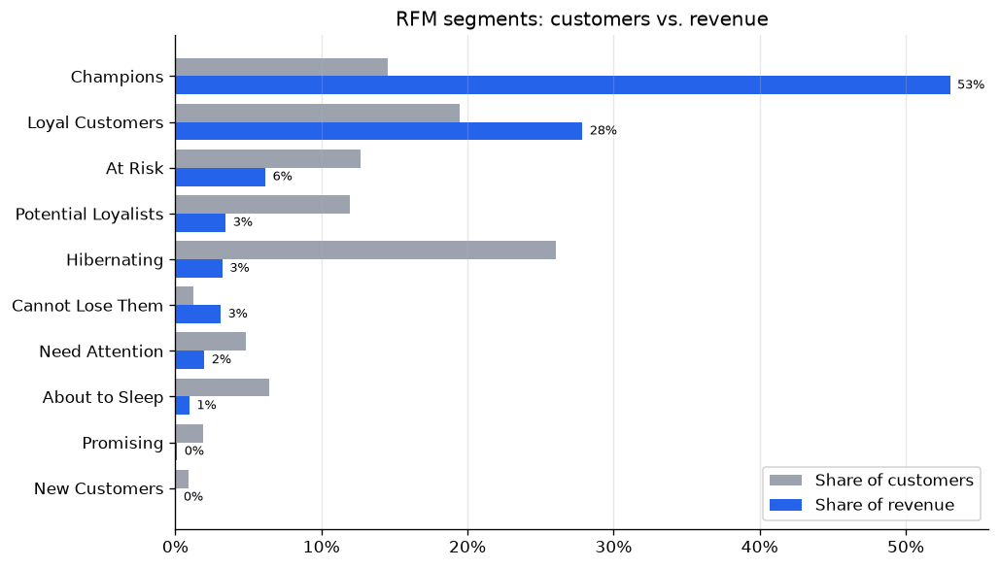
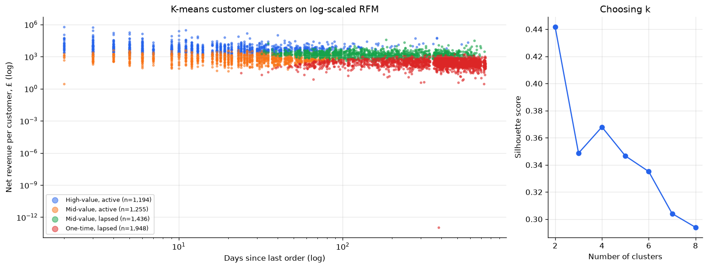
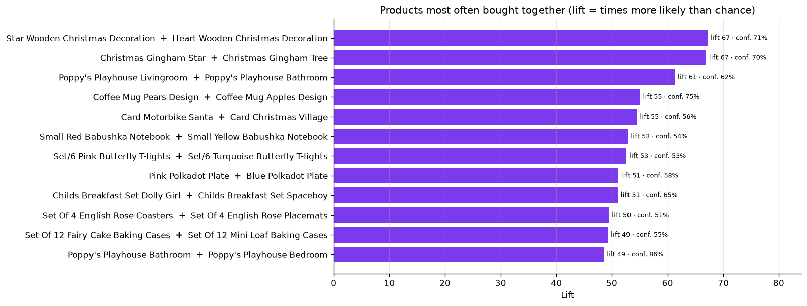
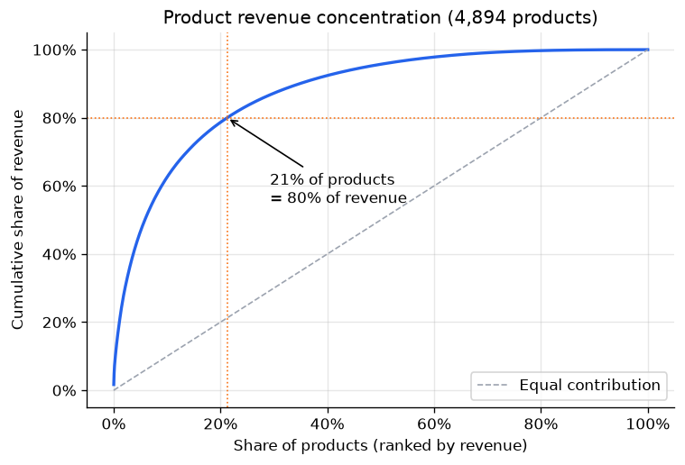
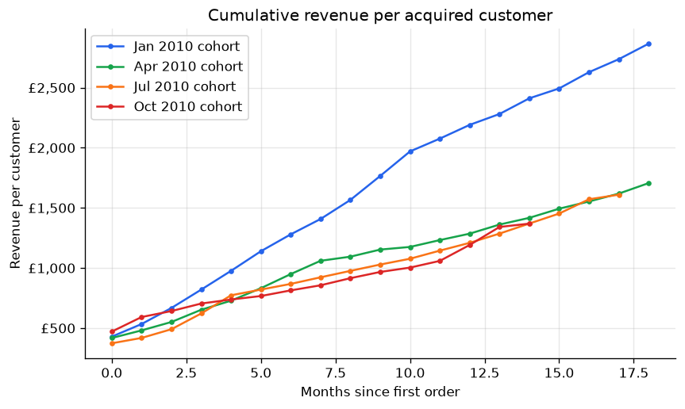

# E-commerce Customer Analytics

[](https://github.com/Fares2311/ecommerce-customer-analytics/actions/workflows/ci.yml)

[](LICENSE)

Two years of transactions from a UK online gift retailer (1.07M invoice lines, 5,900 customers,
£18.9M net revenue), analysed to answer the questions a commercial team would ask: how is the
business trending, do customers come back, who are the valuable and the at-risk customers, and
which products sell together?

Every metric is a SQL view in [`sql/`](sql) (CTEs, window functions, `NTILE`, date arithmetic,
self-joins), run by DuckDB directly on Parquet. Python only runs the SQL, clusters customers
and draws the charts. The write-up with recommendations is the
[report notebook](notebooks/customer_analytics_report.ipynb).

## Key findings

- Revenue is **flat** year over year (+2% from January to November) and peaks every November at
  about twice a summer month.
- **New customers per month halved** in 2011 (from 280 to 137), and 90% of revenue now comes
  from returning customers.
- After their first order, about **22% of a cohort orders again** in any given month, and this
  stays stable for a full year.
- **Champions** are 15% of customers but **53% of revenue**. The top 1% of customers alone
  bring 31%.
- **813 at-risk customers** (frequent buyers who have been silent for about a year) represent
  **£1.5M** of past revenue.
- **21% of products make 80% of revenue**, and variants of the same product family are bought
  together far more than by chance (lift up to 67).

## Recommendations

1. Run a win-back campaign for the *At Risk* and *Cannot Lose Them* segments (813 customers).
2. Set up key-account management for the top 1% of customers (31% of revenue).
3. Look into acquisition: new customers halved, and revenue only held up thanks to existing ones.
4. Offer bundles and "frequently bought together" suggestions for product families.
5. Start Q4 campaigns in September, when the seasonal ramp-up begins.

## Analyses

<table>
<tr>
<td width="50%"><br>
<b>Monthly KPIs</b>: net revenue, returns, new vs. returning customers
(<a href="sql/02_monthly_kpis.sql">SQL</a>)</td>
<td width="50%"><br>
<b>Cohort retention</b>: share of each monthly cohort that orders again
(<a href="sql/03_cohorts.sql">SQL</a>)</td>
</tr>
<tr>
<td><br>
<b>RFM segmentation</b>: quintile scores and the usual 10-segment grid
(<a href="sql/04_rfm.sql">SQL</a>)</td>
<td><br>
<b>K-means check</b>: clusters on log-scaled RFM, k chosen by silhouette score
(<a href="src/retail/segmentation.py">Python</a>)</td>
</tr>
<tr>
<td><br>
<b>Market basket</b>: support, confidence and lift from an order self-join
(<a href="sql/06_market_basket.sql">SQL</a>)</td>
<td><br>
<b>Product concentration</b>: Pareto curve with running sums
(<a href="sql/05_products.sql">SQL</a>)</td>
</tr>
<tr>
<td><br>
<b>Customer value over time</b>: cumulative revenue per new customer
(<a href="sql/07_customer_value.sql">SQL</a>)</td>
<td>

**RFM segments**

| Segment | Customers | Revenue share |
|---|---|---|
| Champions | 846 | 53.0% |
| Loyal Customers | 1,138 | 27.9% |
| At Risk | 739 | 6.2% |
| Potential Loyalists | 699 | 3.5% |
| Hibernating | 1,520 | 3.2% |
| Cannot Lose Them | 74 | 3.1% |
| Need Attention | 280 | 2.0% |
| About to Sleep | 374 | 1.0% |
| Promising | 111 | 0.1% |
| New Customers | 53 | 0.1% |

</td>
</tr>
</table>

## Data cleaning

The raw data needs a fair amount of cleaning. Each rule is in
[`sql/01_staging.sql`](sql/01_staging.sql) and has a test on a hand-made fixture
([`tests/test_sql.py`](tests/test_sql.py)).

| Step | Lines |
|---|---|
| Raw invoice lines | 1,067,371 |
| Exact duplicates removed | 34,335 |
| Non-product codes removed (postage, Amazon fees, bank charges, vouchers, test items) | 5,817 |
| Zero or negative prices removed | 5,961 |
| Bad-debt adjustments removed | 6 |
| **Clean lines** (sales + returns) | **1,021,252** |
| of which returns (`C` invoices) | 17,914 |
| of which guest checkouts without a customer ID | 227,089 |

Returns are kept as negative lines instead of being dropped, so customer revenue is net of
cancellations. This matters: one customer ordered 80,995 units and cancelled 12 minutes later.

## SQL used

| Technique | Where |
|---|---|
| CTE pipelines, `SELECT DISTINCT` de-duplication, regex filters | `01_staging.sql` |
| Conditional aggregation (`FILTER (WHERE …)`), `arg_min` | `01`, `02` |
| Cohorts with `date_diff('month', …)` | `03_cohorts.sql`, `07_customer_value.sql` |
| `NTILE` scores with tie-breaking, `CASE` segment grid, `median` | `04_rfm.sql` |
| Running totals with `ROWS UNBOUNDED PRECEDING` | `05_products.sql` |
| Self-join for product pairs, support / confidence / lift | `06_market_basket.sql` |
| `percent_rank`, cross join with `VALUES` | `07_customer_value.sql` |
| Share of total with `sum(…) OVER ()` | `04`, `08_countries.sql` |

## Run it

```bash
git clone https://github.com/Fares2311/ecommerce-customer-analytics.git
cd ecommerce-customer-analytics
python -m venv .venv && source .venv/bin/activate
make install     # pip install -e ".[dev]"
make run         # downloads the dataset (45 MB, once) and runs everything in ~20 s
make notebook    # re-runs the report notebook
make test        # SQL and segmentation tests
```

Results go to `reports/results/*.csv` (one file per view) and `reports/figures/`. To explore
the views yourself:

```python
from retail.analysis import connect
con = connect()
con.sql("select * from rfm_segment_summary").show()
```

## Project structure

```
├── sql/                       # one file per question, run in order
│   ├── 01_staging.sql         # cleaning rules, orders, customers
│   ├── 02_monthly_kpis.sql
│   ├── 03_cohorts.sql
│   ├── 04_rfm.sql
│   ├── 05_products.sql
│   ├── 06_market_basket.sql
│   ├── 07_customer_value.sql
│   └── 08_countries.sql
├── src/retail/                # download, SQL runner, K-means, plots, CLI
├── notebooks/                 # report notebook
├── reports/                   # exported results, figures, summary.json
└── tests/                     # SQL logic tested on a hand-made fixture
```

## Limitations

- Only two years of data. The December 2009 cohort also contains customers who existed before
  the data starts, so its retention looks better than it is.
- All values are revenue in GBP, not profit: costs and margins aren't in the data.
- About 22% of lines have no customer ID and are left out of the customer-level analyses.

## Data

[Online Retail II](https://archive.ics.uci.edu/dataset/502/online+retail+ii) (Chen, 2019), UCI
Machine Learning Repository, licensed CC BY 4.0. Downloaded at runtime, not stored in this
repository.
